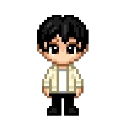

# Joy Patel — Software Engineer & Applied AI Portfolio

> **Cinematic, high-performance portfolio featuring an editorial crimson aesthetic, 3D interactive skill orbit, cursor-tracking mascot, interactive developer terminal, and smooth canvas scroll synchronization.**



---

## ✦ Key Features

- **Cinematic Crimson & Dark Burgundy Architecture**: Bespoke design language with deep charcoal surfaces, ambient ruby lighting, and editorial typography (Syne + JetBrains Mono).
- **Interactive 3D Skill Universe Orbit**: Custom planetary orbit visualizing technical competencies across Languages, Frameworks, and Tools/Databases with cinematic focus zoom and interactive details.
- **Interactive 3D Mascot & Developer Terminal**: A cursor-tracking 3D robot companion rendered at 60fps via canvas 2D frame interpolation with zero external 3D runtime overhead. Clicking the robot opens an interactive dev terminal with custom CLI commands (`help`, `skills`, `projects`, `exp`, `resume`, `contact`, `clear`).
- **Scroll-Synchronized Character Canvas Engine**: Multi-frame sequence smoothly driven by smooth-scroll progress (Lenis + GSAP ScrollTrigger).
- **Ambient Dual-Track Music Player**: Continuous background soundtrack alternating between ambient tracks with a live animated equalizer button and mute toggle.
- **Ultra-Responsive Across All Screens**: Fully optimized from 4K ultra-wide monitors down to standard laptops, tablets, and 320px mobile screens with zero layout glitches or horizontal clipping.

---

## ✦ Tech Stack

- **Core**: Vanilla HTML5, CSS3, JavaScript (ES6+ Modules)
- **Animation & Physics**: [GSAP](https://greensock.com/gsap/) (GreenSock Animation Platform) + ScrollTrigger
- **Smooth Scrolling**: [Lenis](https://lenis.darkroom.engineering/) Smooth Scroll
- **Visuals**: Canvas 2D frame sequencing, Devicon SVG icons, WebP optimized sequences

---

## ✦ Project Structure

```text
├── index.html               # Main portfolio entry point
├── Joypatel-resume.pdf      # Official downloadable resume
├── hero.png                 # Social preview image & favicon
├── skill-orbit.css          # Skill Universe Orbit styling & animations
├── skill-orbit.js           # 3D Orbit physics, orbital rotation & zoom
├── robot-tracker.css        # Robot companion container & HUD styling
├── robot-tracker.js         # Head-tracking interpolation & canvas engine
├── assets/
│   ├── tap.png              # Central orbit core icon
│   └── frames/              # Optimized 3D robot head WebP sequence
├── Char/                    # Scroll-synced canvas background sequence
├── music/                   # Curated ambient soundtrack audio files
└── vendor/                  # GSAP, ScrollTrigger, and Lenis runtimes
```

---

## ✦ Deployment

This project is a 100% static, production-ready website with zero build steps or server dependencies required.

### Deploy to Vercel
```bash
# Using Vercel CLI
npx vercel
```
Or simply import your repository into the [Vercel Dashboard](https://vercel.com/new).

### Deploy to Render
1. Push this repository to GitHub.
2. In the [Render Dashboard](https://dashboard.render.com), click **New +** $\rightarrow$ **Static Site**.
3. Connect your repository.
4. Set **Publish Directory** to `.` and leave **Build Command** blank.
5. Click **Create Static Site**.

### Deploy to Netlify
- Drag and drop this folder into [Netlify Drop](https://app.netlify.com/drop), or connect your repository.
- **Publish directory**: `.` (root)

### Deploy to GitHub Pages
1. Push this repository to GitHub.
2. Go to **Settings** > **Pages**.
3. Under **Branch**, select `main` and `/ (root)`, then click **Save**.

---

## ✦ License & Attribution

Designed and engineered by **Joy Patel**.  
All rights reserved.
